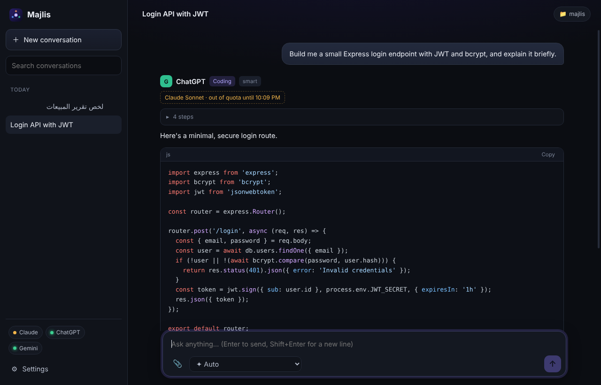
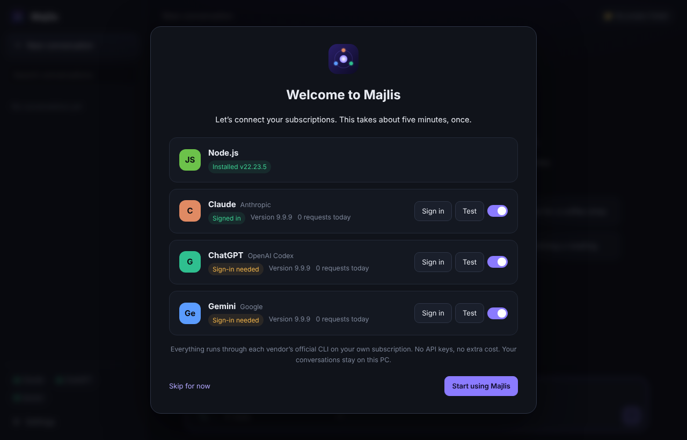
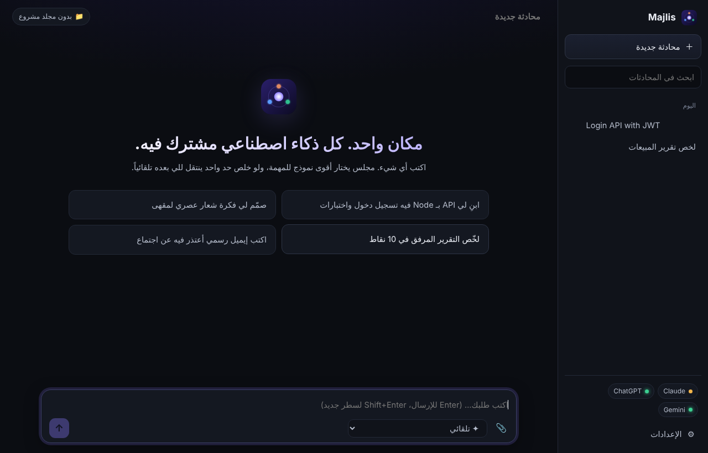
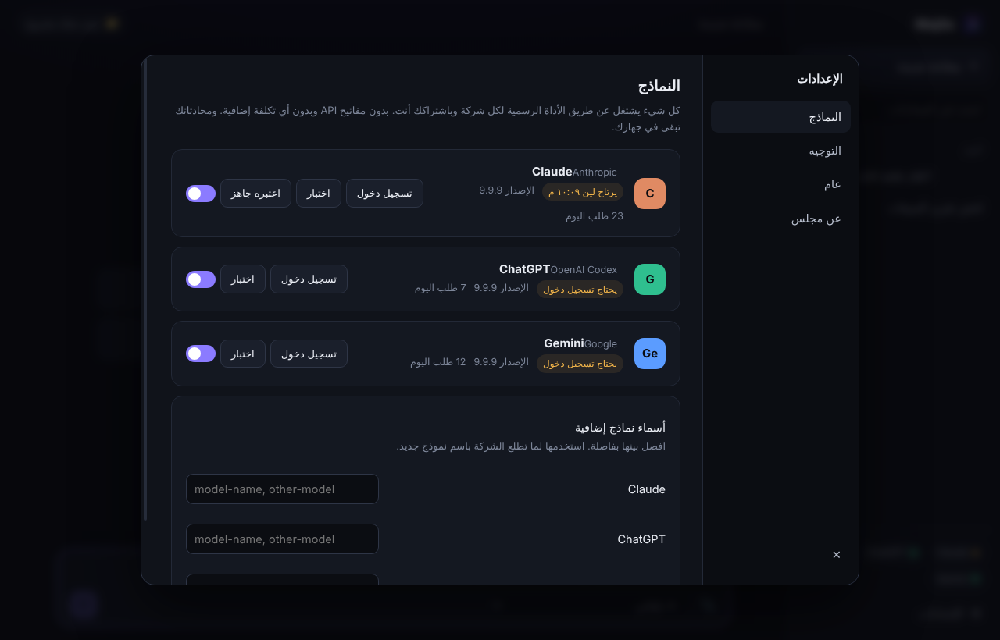

<p align="center"></p>
<h1 align="center">Majlis</h1>
<p align="center"><b>One desktop app for every AI you already pay for.</b><br>
Claude · ChatGPT (Codex) · Gemini (Google Antigravity) — in one window, with smart routing and automatic fallback.</p>

<p align="center"></p>

## Why

You have several AI subscriptions, and each one is best at something different. Each one also runs out at the worst moment. Majlis puts them all in one place:

- **Smart routing**: a fast model reads each request and sends it to the strongest model for that kind of work. Heavy coding goes to Claude Opus, research and long files go to Gemini Pro, images go to ChatGPT, and so on. You can change every route.
- **Automatic fallback**: when a model hits its usage limit, Majlis parks it until its quota resets, then continues **the same conversation** on the next model, with the full context.
- **Uses your subscriptions, not API keys**: everything runs through each vendor's official CLI (Claude Code, Codex CLI, Google Antigravity CLI) signed in with your own account. There are no extra costs and no scraping.
- **Every model your plans include, listed live**: Claude Fable/Opus/Sonnet/Haiku, the GPT models in your ChatGPT plan, and Google's Gemini models — read from each tool, so new models appear automatically.
- **Works on your projects**: pick a project folder and the models can read and edit its files directly. You choose how much they're allowed to do.
- **Talk to it**: press 🎙 (or `Ctrl+M`) and speak. Speech is recognised **on your PC** by Whisper large-v3 turbo (on the graphics card when available): accurate Arabic and English, free, works offline, no account needed. The model (~1 GB) downloads once in the background. **Voice chat** 🎧 makes it hands-free: you talk, the answer is read aloud, and it keeps listening, while the models still do the full task (code, files, research).
- **Learns your taste**: 👍 / 👎 on any answer re-orders the routes over time.
- **Feels native**: a real Windows app with an installer, tray icon, global shortcut (`Ctrl+Shift+Space`), notifications, drag-and-drop attachments, saved conversations, full Arabic (RTL) and English UI, and auto-updates.

| Setup in one screen | Arabic UI | Settings |
|---|---|---|
|  |  |  |

## Install

Open **PowerShell** (Start menu → type `PowerShell`) and paste:

```powershell
irm https://raw.githubusercontent.com/abdullah7979/majlis/main/install.ps1 | iex
```

That single line installs whatever is missing — Node.js, the official Claude Code / Codex / Antigravity CLIs — then Majlis itself (Start menu + desktop shortcut) and opens it. On first launch, click **Sign in** for each subscription you have:

- **Claude** → choose *Claude account (Pro/Max)*
- **ChatGPT** → choose *Sign in with ChatGPT*
- **Gemini** → choose *Login with Google*

Prefer clicking? Download `Majlis-Setup-x.y.z.exe` from [Releases](../../releases). (It isn't code-signed yet, so Windows may show “unrecognized app” → *More info* → *Run anyway*.)

Majlis updates itself automatically.

## How routing works

| Task type | Default order (first available wins) |
|---|---|
| Heavy coding (apps, refactors, architecture) | Claude Opus → ChatGPT → Gemini Pro |
| Coding (fixes, snippets) | Claude Sonnet → ChatGPT → Gemini Pro |
| Images & design | ChatGPT → Gemini Pro → Claude Sonnet |
| Research & files | Gemini Pro → Claude Sonnet → ChatGPT |
| Writing | Claude Sonnet → Gemini Pro → ChatGPT |
| Live info | Gemini Pro → ChatGPT → Claude Sonnet |
| Quick questions | Gemini Flash → Claude Haiku → ChatGPT |

- The router is a fast model (Gemini Flash by default). If it's unavailable, Majlis falls back to instant keyword routing in Arabic and English.
- A model that answers "usage limit reached" is put on cooldown until the reset time it reports, or for 60 minutes if it gives none. It's skipped until then, and you can mark it ready manually.
- If a vendor renames a model, Majlis retries with that CLI's default model, and you can add new model names in **Settings → Models**.
- You can always pick a specific model from the composer and skip routing.

## Permissions

Under **Settings → General → What models may do on your PC**:

- **Read only**: the models answer and never change files.
- **Edit files in the project folder** (the default): the models can create and modify files in the folder you picked.
- **Full access**: the models can run any command without asking. Only use this on folders you trust them with.

## Honest limitations

- **Grok** has no official subscription-based CLI, so it isn't included yet.
- **Image generation**: the CLIs are great at designing (SVG, HTML/CSS, code-drawn graphics, prompts), but photo-style generation is more limited than in the vendors' own apps.
- Each vendor's terms and quotas still apply. Majlis doesn't bypass any limit; it simply moves on to another subscription you own.
- Sign-in status is a best-effort check of each CLI's credential file. Use **Test** for a definitive answer.

## Development

```bash
npm install
npm start          # run the app
npm test           # engine tests against fake CLIs (runs on Windows + Linux in CI)
npm run smoke      # boot the app and exit
npm run dist       # build the Windows installer into dist/
```

Releases: push a tag such as `v0.2.0` and GitHub Actions builds, tests and publishes the installer. Installed apps update themselves.

Architecture:

```
src/core/      engine (no Electron): providers, router, fallback, storage. Fully unit-tested
src/main/      Electron main process: window, tray, IPC, updater
src/renderer/  UI (vanilla JS, no build step)
test/          fake claude/codex/gemini CLIs + end-to-end engine tests
```

Data (conversations, settings) lives in `%APPDATA%\Majlis\data` and never leaves your PC.

MIT License.

## Connect other systems (local API)

Settings → **Connect (API)** → turn it on. Majlis then serves an OpenAI-compatible API on `http://127.0.0.1:4891/v1`
(key shown in the same screen). Anything that talks to OpenAI can use your subscriptions through Majlis:

```python
from openai import OpenAI
client = OpenAI(base_url="http://127.0.0.1:4891/v1", api_key="mj-…")
r = client.chat.completions.create(model="majlis-auto", messages=[{"role": "user", "content": "Summarize this…"}])
```

Models: `majlis-auto` (Majlis picks), `majlis-council` (all three, merged), or a specific one such as `claude:opus`,
`codex:gpt-6-luna`, `gemini:default`. Streaming (`"stream": true`) is supported. API requests are read-only by default.

## Automations

⏰ **Automations** in the sidebar: write a task once (a morning brief, a weekly report…), choose *every day at*,
*chosen weekdays* or *every N hours*. Majlis runs it on time, keeps the results in the task's own conversation and
shows a notification.

## Prompts

✨ **Improve** (Ctrl+I) rewrites a rough request into a strong prompt before sending. Type `/` in the message box for
your prompt library (edit it in Settings → Prompts). Asking Majlis to *write a prompt* routes to the best prompt engineer.
